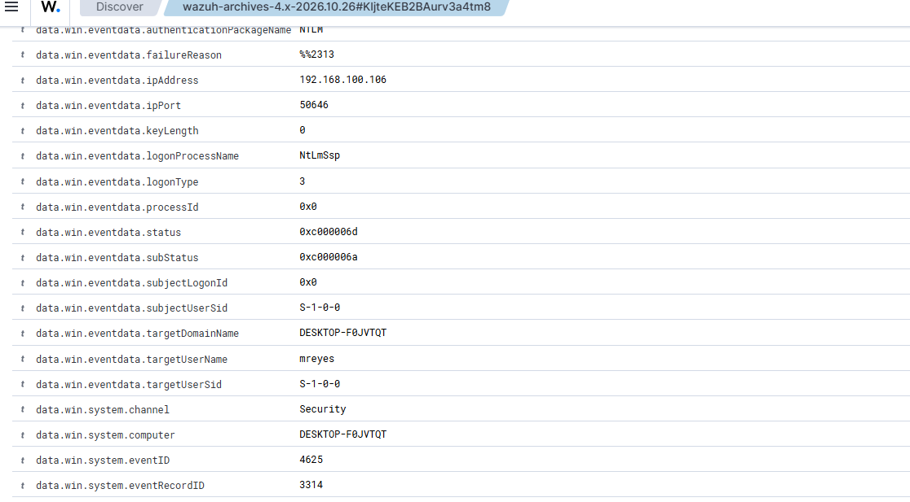
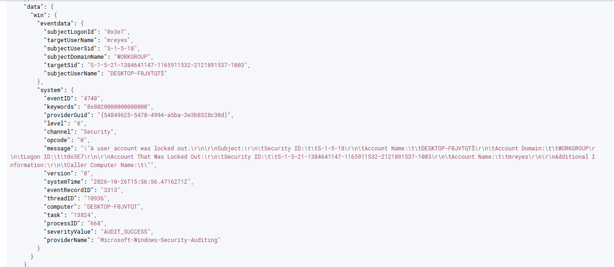
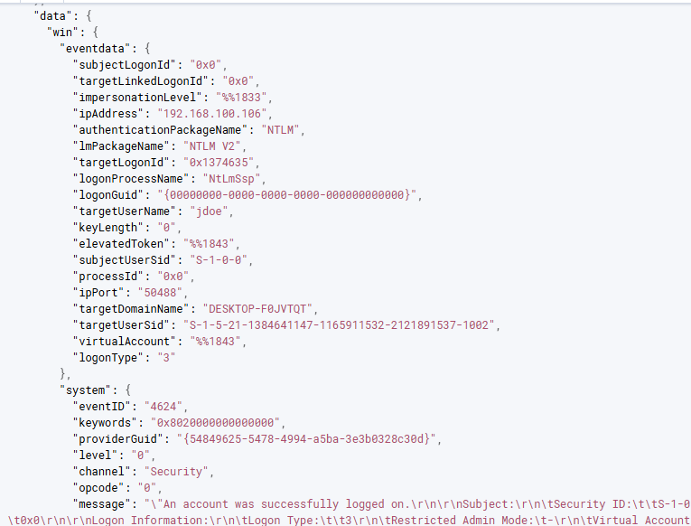

# 03 — Alert / Detection (actual events)

Detection confirmed via Wazuh archives (`wazuh-archives-4.x-2026.10.26`) and Security Events. All events from agent `winhome01` (192.168.100.108), source IP `192.168.100.106`.

## Events observed

| Windows Event ID | Meaning | Count | Time (UTC+8) | Evidence |
|---|---|---|---|---|
| **4625** | An account failed to log on | ~41 (raw, archives) | 23:50–00:00, peak 23:56–23:57 | `06-wazuh-4625-burst.png`, `10-wazuh-archives-burst.png` |
| **4740** | A user account was locked out | 1 — `mreyes` | 23:56:56 | `09-wazuh-4740-lockout.png` |
| **4624** | Successful logon (type 3) | 2 — `jdoe`, `adminlab` | within burst | `08-wazuh-4624-success.png` |

## 4625 failure — expanded fields (from evidence)

| Field | Value |
|---|---|
| `data.win.system.eventID` | 4625 |
| `data.win.system.channel` | Security |
| `data.win.system.computer` | DESKTOP-F0JVTQT |
| `data.win.eventdata.ipAddress` | **192.168.100.106** (attacker) |
| `data.win.eventdata.ipPort` | 50646 (sample) |
| `data.win.eventdata.targetUserName` | mreyes / jdoe / adminlab / guest / administrator |
| `data.win.eventdata.targetDomainName` | DESKTOP-F0JVTQT |
| `data.win.eventdata.logonType` | **3** (Network — SMB) |
| `data.win.eventdata.status` | `0xc000006d` |
| `data.win.eventdata.subStatus` | `0xc000006a` (wrong password) |
| `data.win.eventdata.failureReason` | %%2313 (Unknown user name or bad password) |
| `data.win.eventdata.authenticationPackageName` | NTLM |
| `data.win.eventdata.lmPackageName` | NTLM V1 (failures) / NTLM V2 (success) |
| `data.win.eventdata.logonProcessName` | NtLmSsp |
| `data.win.system.eventRecordID` | 3314 (sample) |

  

## 4740 lockout — expanded

- `targetUserName: mreyes` (account locked out)
- `subjectUserName: DESKTOP-F0JVTQT$` (the computer itself, as expected for local lockout)
- `subjectDomainName: WORKGROUP`
- `systemTime: 2026-10-26T15:56:56.471627Z` = **23:56:56 UTC+8**

  

## 4624 success — expanded

- `targetUserName: jdoe` (and `adminlab`)
- `ipAddress: 192.168.100.106`, `ipPort: 50488` (sample)
- `logonType: 3`, `authenticationPackageName: NTLM`, `lmPackageName: NTLM V2`
- message: "An account was successfully logged on."

  

## Wazuh rule IDs

Built-in rule IDs vary by Wazuh version. In this deployment, detection was validated through the raw event stream (archives) with the fields above; Security Events alert rule IDs (4625 / 4740 / 4624) are not the primary evidence source here.
