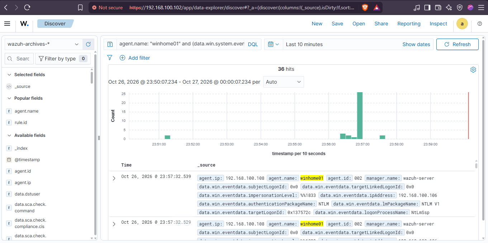
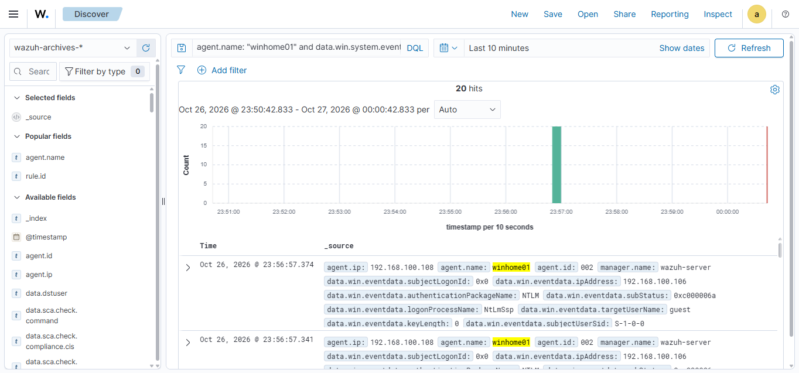
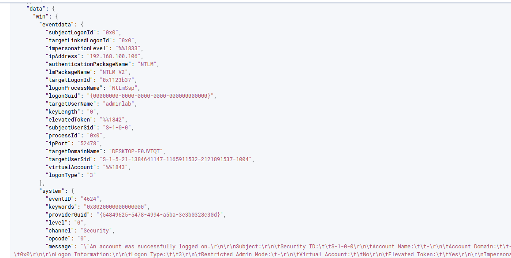
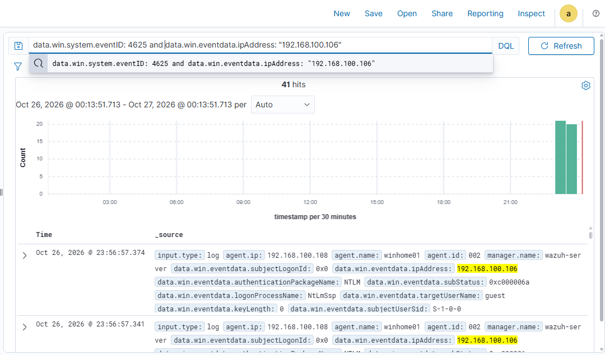
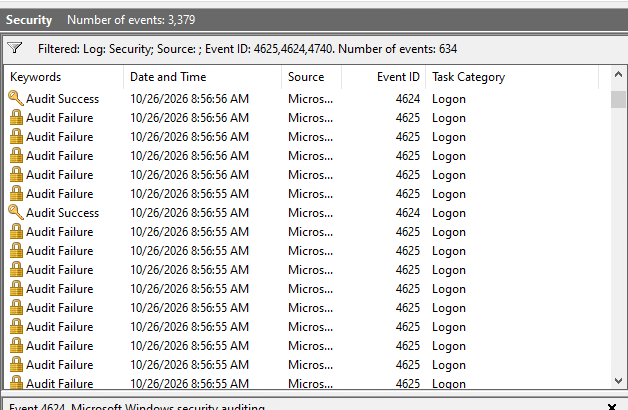

# SOC Case — Brute Force Attack (SMB)

**Week:** 1 — Windows Fundamentals
**Lab:** Attacker (`192.168.100.106`) → Windows 10 Home (`192.168.100.108`, agent: `winhome01` / hostname `DESKTOP-F0JVTQT`), detected by Wazuh SIEM (`192.168.100.102`)
**ATT&CK:** T1110.001 — Brute Force (Password Guessing)
**MITRE Tactic:** Credential Access
**Severity:** **Critical** — brute force succeeded against a local administrator account
**Status:** ✅ Completed (2026-10-26)

## Case Structure

| File | Contents |
|---|---|
| `01-Scenario.md` | Background, lab setup, accounts created |
| `02-Attack-Simulation.md` | Kali step-by-step (recon → NetExec brute force → successful admin access) |
| `03-Alert.md` | Events detected by Wazuh (4625 burst, 4740 lockout, 4624 success) |
| `04-Indicators.md` | IOCs: source IP, accounts, event IDs, status/substatus codes |
| `05-Investigation.md` | Triage steps in Wazuh Discover/archives + evidence list |
| `06-Timeline.md` | Real event timeline (UTC+8) |
| `07-Analysis.md` | What happened, logon type 3, brute-force signature |
| `08-Conclusion.md` | Findings, severity, lessons learned |
| `09-Remediation.md` | Hardening applied + custom detection rule |
| `evidence/` | Screenshots (11 images) |
| `kali-commands.txt` | Exact commands run on Kali |

## Result Summary (actual, from evidence)

- **Attacker IP (observed in logs):** `192.168.100.106` (Kali — note: configured as .107 but attack sourced from .106; verify DHCP reservation)
- **Target:** `192.168.100.108` (winhome01 / DESKTOP-F0JVTQT), SMB TCP/445, Windows 10 Build 19041 x64, workgroup
- **Failed logons (4625):** ~41 (raw count in `wazuh-archives-*`), peak 2026-10-26 23:56–23:57 UTC+8
- **Account lockouts (4740):** 1 — `mreyes` locked at 23:56:56 UTC+8
- **Successful logons (4624, type 3):** 2 — `jdoe:Password1` and `adminlab:P@ssw0rd` (adminlab = local administrator → `(Pwn3d!)`)
- **Outcome:** attacker obtained local admin access via SMB (ADMIN$/C$ shares enumerated). Contained: passwords rotated, lockout policy enforced.
- **Key finding:** Hydra failed outright — SMBv1 disabled on target (secure default); attacker pivoted to NetExec (SMBv2/3). Documented as detection-engineering lesson.

## Evidence Gallery

### Kali attack screenshots

  

  

  

### Wazuh screenshots

  

  

  

  

  

  

  

### Host evidence

  

